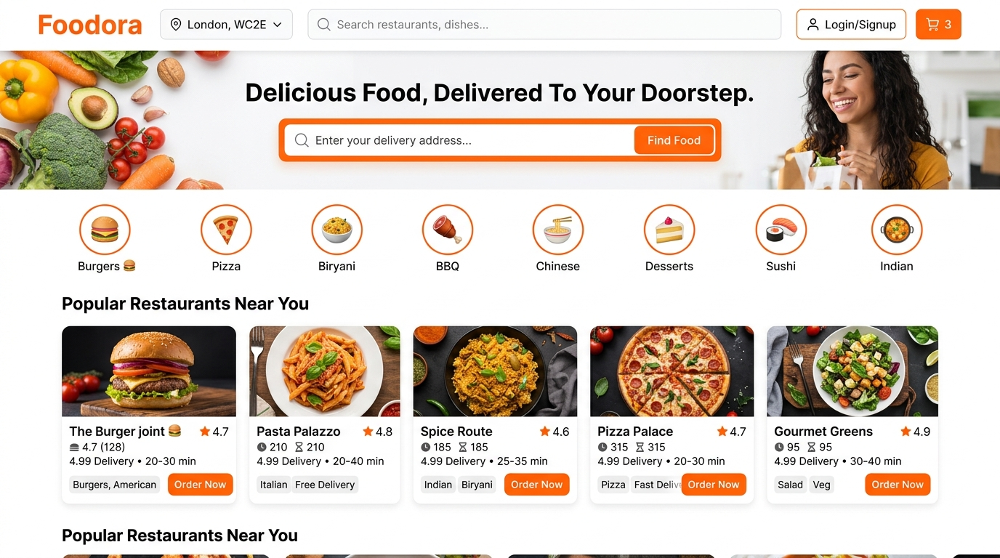
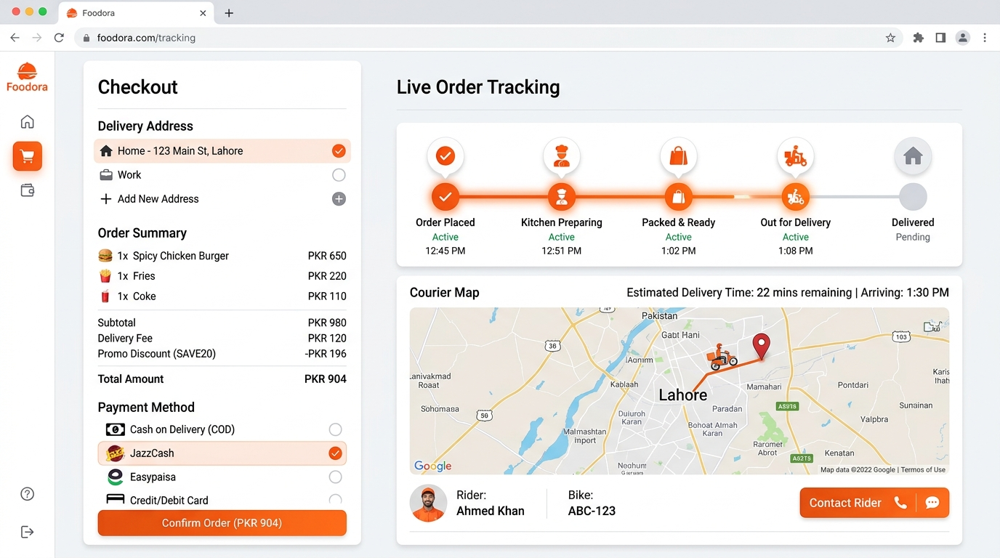
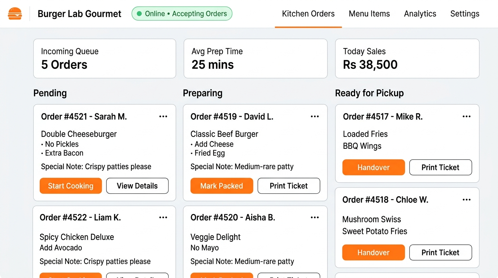
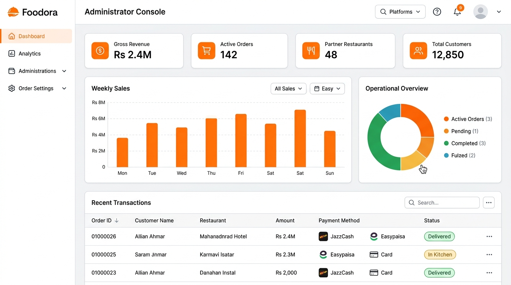

# 🍔 Foodora SaaS - Complete Professional Food Delivery Platform

[-orange.svg)](https://github.com)
[](https://github.com)
[](https://github.com)
[](https://github.com)

> **Foodora SaaS** is a modern, premium, full-scale food delivery and restaurant management web application. It delivers an end-to-end food ordering experience—from restaurant discovery and food customization to a live shopping cart, checkout, simulated multi-stage order tracking, and three distinct dashboard experiences (Customer, Restaurant Owner Kitchen Terminal, and Platform Admin Console).

---

## 📌 Table of Contents
- [Executive Overview](#-executive-overview)
- [Application Showcase & Visual Screenshots](#-application-showcase--visual-screenshots)
- [Design System & Visual Identity](#-design-system--visual-identity)
- [System Accounts & Sign-In Access](#-system-accounts--sign-in-access)
- [Complete Project Directory Architecture](#-complete-project-directory-architecture)
- [Full Application Sitemap](#-full-application-sitemap)
- [Core Feature Highlights](#-core-feature-highlights)
  - [1. Authentication UI (Split-Screen)](#1-authentication-ui-split-screen)
  - [2. Customer Marketplace Experience](#2-customer-marketplace-experience)
  - [3. Interactive Cart & Checkout](#3-interactive-cart--checkout)
  - [4. Visual Order Tracking Timeline](#4-visual-order-tracking-timeline)
  - [5. Customer Dashboard & Profile](#5-customer-dashboard--profile)
  - [6. Restaurant Owner Kitchen Terminal](#6-restaurant-owner-kitchen-terminal)
  - [7. Platform Administrator Console](#7-platform-administrator-console)
- [Data Persistence & State Management](#-data-persistence--state-management)
- [Step-by-Step Setup & Running Guide](#-step-by-step-setup--running-guide)
- [Production Architecture Disclaimer](#-production-architecture-disclaimer)

---

## 🌟 Executive Overview
Foodora SaaS is constructed following high-end SaaS product design standards:
- **Zero Backend / Zero Setup:** No Node.js server, PHP, Firebase, Supabase, MySQL, or MongoDB dependencies required.
- **Pure Web Standards:** Built using Semantic HTML5, Modular CSS3 (Variables, Grid, Flexbox, Keyframe Animations), and Vanilla ES6+ JavaScript.
- **LocalStorage State Machine:** Maintains full CRUD persistence for restaurants, menu dishes, shopping cart items, promo codes, delivery addresses, reviews, and orders across browser sessions.
- **Dark & Light Mode:** Full dual-theme system built into CSS variables with automatic persistence.
- **Multi-Role Experience:** Includes 3 dedicated dashboard portals:
  1. **Customer Portal:** Order history, favorites, address book, notification preferences.
  2. **Restaurant Owner Terminal:** Kitchen queue dispatch, dish availability toggling, print kitchen tickets, sales analytics.
  3. **Admin Console:** Platform KPI metrics, restaurant CRUD, product CRUD, category editor, coupon engine, review moderation.

---

## 📸 Application Showcase & Visual Screenshots

### 1. Master Customer Marketplace Homepage
*Discover top-rated restaurants, dynamic categories, real-time address bar, and trending dishes with quick order buttons.*
<p align="center">
  
</p>

### 2. Interactive Checkout & 5-Phase Live Order Tracking
*Two-column checkout flow with payment options (COD, JazzCash, Easypaisa, Card) and an active multi-stage timeline runner with rider map details.*
<p align="center">
  
</p>

### 3. Restaurant Owner Kitchen Dispatch Terminal
*Live kitchen queue with customized orders, special chef notes, cooking status transitions, and thermal ticket printing.*
<p align="center">
  
</p>

### 4. Platform Administrator Console
*Enterprise analytics overview with weekly revenue flex bar chart, partner restaurant management, and real-time transaction registry.*
<p align="center">
  
</p>

---

## 🎨 Design System & Visual Identity

The design system incorporates vibrant orange CTA accents, clean white surfaces, soft shadows, rounded corners, and crisp typography:

| Design Token | Value | Purpose |
| :--- | :--- | :--- |
| **Primary Orange** | `#FF7518` | Primary brand accent, primary CTA buttons, active tabs |
| **Primary Dark / Hover** | `#E05D07` | Hover and active states for primary buttons |
| **Primary Light** | `#FFF1E6` | Soft highlight badges, light card accents, selected chips |
| **Pure White** | `#FFFFFF` | Card backgrounds, panel surfaces, navigation bar |
| **Canvas Background** | `#F8F8F8` | Global page body background |
| **Dark Heading Text** | `#202020` | Headings, card titles, prominent text |
| **Muted Body Text** | `#777777` | Captions, secondary information, subtitles |
| **Border Color** | `#EEEEEE` | Dividers, table borders, card outlines |
| **Success Green** | `#22A06B` | Order delivered badges, in-stock pills, positive metrics |
| **Warning Amber** | `#F59E0B` | In-progress orders, preparing food statuses, ratings |
| **Danger Red** | `#E5484D` | Cancelled badges, out-of-stock items, delete buttons |
| **Typography** | `Plus Jakarta Sans`, `Inter`, sans-serif | Modern SaaS typography with variable weights |

---

## 🔑 System Accounts & Sign-In Access

Foodora SaaS features full user authentication with account registration, password validation, session persistence, and role-based routing:

| Role | Email Address | Password | Access Portal |
| :--- | :--- | :--- | :--- |
| **Customer** | `customer@foodora.com` (or `alex@foodora.com`) | `password123` | [`login.html`](login.html) ➔ [`dashboard/customer/index.html`](dashboard/customer/index.html) |
| **Restaurant Owner** | `owner@foodora.com` | `password123` | [`dashboard/owner/login.html`](dashboard/owner/login.html) ➔ [`dashboard/owner/index.html`](dashboard/owner/index.html) |
| **Platform Admin** | `admin@foodora.com` | `password123` | [`dashboard/admin/login.html`](dashboard/admin/login.html) ➔ [`dashboard/admin/index.html`](dashboard/admin/index.html) |

*You can also create any brand new customer account at [`register.html`](register.html) with full validation and immediate dashboard access.*

---

## 📁 Complete Project Directory Architecture

```
foodora-saas/
├── index.html                       # Master Homepage & Landing Showcase
├── login.html                       # Split-Screen Customer Sign In
├── register.html                    # Split-Screen Registration Page
├── forgot-password.html             # Simulated Password Reset Screen
│
├── pages/
│   ├── restaurants.html             # Restaurant Marketplace with Multi-Filters
│   ├── restaurant-details.html      # Restaurant Hero, Categorized Menu & Reviews
│   ├── food-details.html            # Product Details, Size Selector & Extras
│   ├── categories.html              # Cuisine Category Directory
│   ├── search.html                  # Global Search with Instant Filters
│   ├── offers.html                  # Deals, Discounts & Active Vouchers
│   ├── cart.html                    # Shopping Cart with Auto Calculations
│   ├── checkout.html                # Multi-Step Two-Column Checkout Experience
│   ├── tracking.html                # Real-Time Visual Order Tracking Timeline
│   ├── orders.html                  # Customer Orders History & Re-order Flow
│   ├── favorites.html               # Saved Favorite Restaurants & Dishes
│   ├── profile.html                 # Customer Account Management
│   ├── addresses.html               # Saved Delivery Addresses CRUD
│   ├── notifications.html           # In-App Notification Center
│   ├── about.html                   # About Foodora SaaS & Brand Mission
│   ├── contact.html                 # Customer Support & Feedback Form
│   ├── privacy.html                 # Privacy Policy Information
│   ├── terms.html                   # Terms & Conditions Information
│   └── 404.html                     # Custom 404 Error Page
│
├── dashboard/
│   ├── customer/
│   │   ├── index.html               # Customer Overview & Active Orders
│   │   ├── orders.html              # Customer Orders Log & Invoices
│   │   ├── favorites.html           # Customer Saved Favorites
│   │   └── profile.html             # Account Details & Password Settings
│   │
│   ├── owner/
│   │   ├── login.html               # Restaurant Partner Sign In
│   │   ├── index.html               # Live Kitchen Terminal & Active Queue
│   │   ├── menu.html                # Menu Management & Add/Edit Dish Modal
│   │   ├── orders.html              # Order Dispatching & Print Ticket Flow
│   │   ├── analytics.html           # Sales Velocity & Best-Seller Analytics
│   │   └── settings.html            # Kitchen Profile, Prep Times & Hours
│   │
│   └── admin/
│       ├── login.html               # Admin Console Sign In
│       ├── index.html               # Platform KPI Metrics & Analytics
│       ├── restaurants.html         # Partner Restaurants CRUD
│       ├── products.html            # Global Products Management
│       ├── categories.html          # Food Categories Management
│       ├── orders.html              # Global Dispatch & Status Overrides
│       ├── customers.html           # Registered Customer Accounts
│       ├── coupons.html             # Promo Code Engine (Percentage / Flat)
│       ├── reviews.html             # Customer Review Moderation
│       └── settings.html            # Platform Preferences & Currency Config
│
├── css/
│   ├── variables.css                # CSS Design Tokens & Dark Mode Overrides
│   ├── global.css                   # CSS Reset, Layout Classes & Utilities
│   ├── components.css               # Header, Footer, Cards, Badges, Modals
│   ├── auth.css                     # Split-Screen Authentication Styling
│   ├── home.css                     # Hero, Promo Grids, Testimonials, Counters
│   ├── restaurant.css               # Filter Toolbar & Restaurant Menu Layouts
│   ├── product.css                  # Customization Drawer & Detail Grid
│   ├── cart.css                     # Cart Rows & Price Breakdown Card
│   ├── checkout.css                 # Two-Column Checkout & Payment Options
│   ├── dashboard.css                # Sidebar, Metric Tiles, Tables & Flex Charts
│   ├── responsive.css               # Mobile Nav Drawer, Breakpoints & Touch UI
│   └── animations.css               # Float, Pulse, Skeleton Shimmers & Fades
│
├── js/
│   ├── data.js                      # Initial Seed Dataset (Dishes, Restaurants, etc.)
│   ├── storage.js                   # LocalStorage Persistent Abstraction Engine
│   ├── validation.js                # Input Validation & XSS String Escaping
│   ├── auth.js                      # Authentication Simulation & Session Manager
│   ├── app.js                       # Global UI, Header Cart Badges, Toast System
│   ├── restaurants.js               # Restaurant Rendering, Filtering & Sorting
│   ├── products.js                  # Product Detail, Extras Calculation & Add to Cart
│   ├── search.js                    # Global Search & Suggestions
│   ├── cart.js                      # Shopping Cart Mechanics & Coupon Verifier
│   ├── checkout.js                  # Checkout Workflow & Order Generator
│   ├── tracking.js                  # Order Timeline Engine & Simulation Controls
│   ├── orders.js                    # Order Invoicing & Re-order Logic
│   ├── favorites.js                 # Wishlist Management
│   ├── notifications.js             # Notification Badges & Actions
│   ├── customer.js                  # Customer Dashboard Controller
│   ├── owner.js                     # Restaurant Owner Kitchen Controller
│   └── admin.js                     # Admin Operations & Chart Renderers
│
└── README.md                        # Master PRD Documentation & Guide
```

---

## 🗺️ Full Application Sitemap

| No. | Page Title | File Location | Key Capabilities |
| :--- | :--- | :--- | :--- |
| **01** | Landing Homepage | [`index.html`](index.html) | Hero, Address finder, Trending dishes, Featured restaurants, Mobile app promo |
| **02** | Customer Sign In | [`login.html`](login.html) | Split-screen orange showcase, clean credential authentication, password toggle |
| **03** | Customer Registration | [`register.html`](register.html) | Account creation simulation with welcome bonus credits |
| **04** | Forgot Password | [`forgot-password.html`](forgot-password.html) | Password reset simulation with instant feedback |
| **05** | Restaurant Directory | [`pages/restaurants.html`](pages/restaurants.html) | Multi-category filters, price slider, delivery time, search bar |
| **06** | Restaurant Details | [`pages/restaurant-details.html`](pages/restaurant-details.html) | Cover banner, cuisine tags, categorized food menu, review modal |
| **07** | Dish Details | [`pages/food-details.html`](pages/food-details.html) | Image gallery, portion size selector, extra toppings, live total calculation |
| **08** | Food Categories | [`pages/categories.html`](pages/categories.html) | Burgers, Pizza, Biryani, BBQ, Chinese, Desserts, Drinks |
| **09** | Global Search | [`pages/search.html`](pages/search.html) | Real-time search across dishes and restaurants with query highlighting |
| **10** | Offers & Promos | [`pages/offers.html`](pages/offers.html) | Copyable promo vouchers (`FOODORA20`, `FREEDELIVERY`, `FLAT150`) |
| **11** | Shopping Cart | [`pages/cart.html`](pages/cart.html) | Item quantity controls, subtotal, delivery fee, discount calculator |
| **12** | Checkout Flow | [`pages/checkout.html`](pages/checkout.html) | Address picker, delivery notes, payment methods (COD, JazzCash, Easypaisa, Card) |
| **13** | Live Order Tracking | [`pages/tracking.html`](pages/tracking.html) | 5-phase visual progress bar, simulated timeline runner, cancel button |
| **14** | Customer Orders | [`pages/orders.html`](pages/orders.html) | Historical orders log, printable receipt modal, 1-click reorder |
| **15** | Saved Favorites | [`pages/favorites.html`](pages/favorites.html) | Wishlist for favorite dining spots and gourmet dishes |
| **16** | Customer Profile | [`pages/profile.html`](pages/profile.html) | Editable name, email, phone, avatar selector |
| **17** | Saved Addresses | [`pages/addresses.html`](pages/addresses.html) | Home, Work, and Custom delivery addresses with "Default" flag |
| **18** | Notification Center | [`pages/notifications.html`](pages/notifications.html) | Order alerts, promotional deal notifications, mark all as read |
| **19** | About Us | [`pages/about.html`](pages/about.html) | Company background, core principles, quality commitments |
| **20** | Help & Contact | [`pages/contact.html`](pages/contact.html) | Frequently asked questions accordion & inquiry submission form |
| **21** | Privacy Policy | [`pages/privacy.html`](pages/privacy.html) | Clear customer privacy policy and data guidance |
| **22** | Terms of Service | [`pages/terms.html`](pages/terms.html) | Standard marketplace terms of service |
| **23** | 404 Error Page | [`pages/404.html`](pages/404.html) | Friendly branded error page with quick links to popular sections |
| **24** | Customer Dashboard | [`dashboard/customer/index.html`](dashboard/customer/index.html) | Overview stats, active delivery badge, quick actions |
| **25** | Owner Login | [`dashboard/owner/login.html`](dashboard/owner/login.html) | Partner login terminal with credential verification |
| **26** | Owner Kitchen Terminal | [`dashboard/owner/index.html`](dashboard/owner/index.html) | Real-time kitchen queue, online/offline toggle, prep times |
| **27** | Owner Menu Editor | [`dashboard/owner/menu.html`](dashboard/owner/menu.html) | Add dish modal, edit pricing, toggle in-stock / out-of-stock |
| **28** | Owner Orders Dispatch | [`dashboard/owner/orders.html`](dashboard/owner/orders.html) | Cooking, Packed, Handover workflow & print kitchen tickets |
| **29** | Owner Sales Analytics | [`dashboard/owner/analytics.html`](dashboard/owner/analytics.html) | Revenue velocity bar charts & top-selling dishes breakdown |
| **30** | Owner Store Settings | [`dashboard/owner/settings.html`](dashboard/owner/settings.html) | Operating hours, prep cadence, delivery charges, banner |
| **31** | Admin Login | [`dashboard/admin/login.html`](dashboard/admin/login.html) | Dedicated administrator sign in |
| **32** | Admin Overview | [`dashboard/admin/index.html`](dashboard/admin/index.html) | Platform metrics, gross revenue, pending dispatches |
| **33** | Admin Restaurants CRUD | [`dashboard/admin/restaurants.html`](dashboard/admin/restaurants.html) | Add/edit restaurant partners, logos, rating overrides |
| **34** | Admin Products CRUD | [`dashboard/admin/products.html`](dashboard/admin/products.html) | Add/edit dishes across all restaurants with image URLs |
| **35** | Admin Categories | [`dashboard/admin/categories.html`](dashboard/admin/categories.html) | Cuisine taxonomy and icon manager |
| **36** | Admin Orders Dispatch | [`dashboard/admin/orders.html`](dashboard/admin/orders.html) | Global order log with manual status override |
| **37** | Admin Customers | [`dashboard/admin/customers.html`](dashboard/admin/customers.html) | Customer registry with order counts & lifetime spend |
| **38** | Admin Coupons | [`dashboard/admin/coupons.html`](dashboard/admin/coupons.html) | Coupon generator with expiration and minimum order rules |
| **39** | Admin Reviews | [`dashboard/admin/reviews.html`](dashboard/admin/reviews.html) | Customer review moderation with approval/delete tools |
| **40** | Admin Settings | [`dashboard/admin/settings.html`](dashboard/admin/settings.html) | Tax rates, delivery fee parameters, platform currency |

---

## ⚡ Core Feature Highlights

### 1. Authentication UI (Split-Screen)
- **Mandatory PRD Design:** Left-side full-height vibrant orange panel featuring professional food photography, floating micro-cards, and promotional guarantees. Right-side clean white surface containing validation-equipped forms.
- **Full Credential Authentication:** Validates real email/password combinations, remembers active customer sessions, and enforces role redirection.
- **Show/Hide Password:** Interactive eye toggle on all password inputs.
- **Forgot Password Simulation:** Instant feedback showing recovery instructions.

### 2. Customer Marketplace Experience
- **Smart Filtering:** Filter restaurants by category (Burgers, Pizza, Biryani, BBQ, Chinese, Desserts), star rating (4.5+, 4.0+), estimated delivery time, and price level.
- **Food Customization:** Product detail pages support portion size selection (Regular, Medium, Large) and optional add-on extras (Extra Cheese, Spicy Sauce, Drink Combo) with **real-time price updates**.
- **Wishlist & Favorites:** Heart icon on every restaurant and food card with instant LocalStorage sync.

### 3. Interactive Cart & Checkout
- **Auto Calculation:** Real-time updates for subtotal, standard delivery fee, and promotional discounts.
- **Coupon Engine:** Supports promo vouchers (`FOODORA20` for 20% off, `FREEDELIVERY` for Rs. 0 delivery, `FLAT150` for Rs. 150 discount) with instant validation messages.
- **Two-Column Checkout:** Select from saved delivery addresses or input a new location, include special chef instructions, choose simulated payment methods (Cash on Delivery, JazzCash, Easypaisa, Debit/Credit Card), and place orders with duplicate-submission protection.

### 4. Visual Order Tracking Timeline
- **5-Phase Progress Bar:** Order Confirmed ➔ Kitchen Preparing ➔ Packed & Ready ➔ Out for Delivery ➔ Delivered.
- **Simulation Control:** Buttons to manually step through or automatically advance order statuses in real-time.
- **Order Cancellation:** Customers can cancel orders while in early statuses.

### 5. Customer Dashboard & Profile
- Overview cards for total orders, total spend, and saved favorites.
- Delivery address manager with "Set as Default" functionality.
- Printable receipt invoices for all past orders.

### 6. Restaurant Owner Kitchen Terminal
- **Live Kitchen Queue:** Order cards displaying customer names, phone numbers, delivery addresses, ordered items with customizations, and special chef notes.
- **Dispatch Workflow:** One-click transition buttons (`Cooking` ➔ `Packed` ➔ `Handover`).
- **Thermal Kitchen Ticket:** Generates a formatted, printable kitchen receipt ticket for chefs.
- **Menu Management:** Add new dishes, edit pricing, or toggle items between "In Stock" and "Out of Stock".
- **Store Status Toggle:** Instantly toggle restaurant between "Online (Accepting Orders)" and "Offline (Closed)".
- **Sales Analytics:** CSS flex bar chart of weekly revenue velocity and top 5 best-selling dishes.

### 7. Platform Administrator Console
- Platform KPI cards (Gross Revenue, Orders Dispatched, Active Partners, Registered Users).
- Complete CRUD interfaces for Restaurants, Food Products, Categories, and Promo Coupons.
- Customer registry with lifetime spend tracking and review moderation tools.

---

## 💾 Data Persistence & State Management

Foodora SaaS uses a modular **`StorageManager` (`js/storage.js`)** engine that interfaces with browser `localStorage`:

- **Automatic Seed Data:** On first visit, pre-populates realistic Pakistani restaurants (Burger Lab Gourmet, Broadway Pizza, Student Biryani, BBQ Tonight, Chop Chop Wok, Bella Gelato), 25+ dishes, active coupon codes, sample reviews, and initial platform users.
- **XSS Protection:** All user-supplied inputs pass through `Validation.escapeHtml()` in `js/validation.js` before DOM insertion.
- **Restore Platform Defaults:** An administrative reset utility is provided to restore baseline defaults at any time.

---

## 🚀 Local Setup & Running Instructions

Foodora SaaS requires **no build step, no compiler, and no server configuration**.

### Method 1: Direct File Opening (Easiest)
Simply double-click [`index.html`](index.html) or open it in any modern web browser (Google Chrome, Mozilla Firefox, Microsoft Edge, Safari).

### Method 2: VS Code Live Server (Recommended for Development)
1. Open the project folder in VS Code.
2. Install the **Live Server** extension by Ritwick Dey.
3. Right-click [`index.html`](index.html) and select **"Open with Live Server"**.

### Method 3: Python Built-In Server
Run the following in the project root:
```bash
python3 -m http.server 8080
```
Then visit: `http://localhost:8080`

### Method 4: Node.js Static Server
```bash
npx serve .
# or
npx http-server -p 8080
```

---

## ⚠️ Production Architecture Disclaimer

> **Important Notice:**
> Foodora SaaS is delivered as a **pure frontend demonstration application**. All authentication actions, checkout flows, payment processing (JazzCash, Easypaisa, Credit Card), and database storage are executed locally within browser memory (`localStorage` and `sessionStorage`).
>
> Prior to deploying this system as a commercial, production-grade SaaS business:
> 1. A secure backend API (e.g. Node.js/Express, Python/FastAPI, or Go) must be implemented.
> 2. Persistent relational/NoSQL databases (PostgreSQL, MongoDB) must be configured with encrypted password hashing (bcrypt/Argon2).
> 3. Real server-side JWT or session authentication must replace client-side role checks.
> 4. PCI-compliant payment gateways (Stripe, JazzCash API, Easypaisa Open API) must handle financial transactions.
> 5. Real-time WebSockets should replace simulated client-side order status intervals.

---

## 📄 License & Attribution
Designed and built for **Foodora SaaS** under Version 1.0 specifications. Free to use and customize for demonstration, educational, and frontend prototyping purposes.
